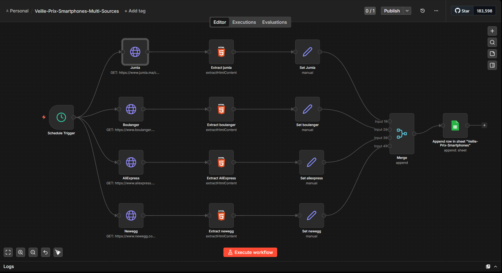
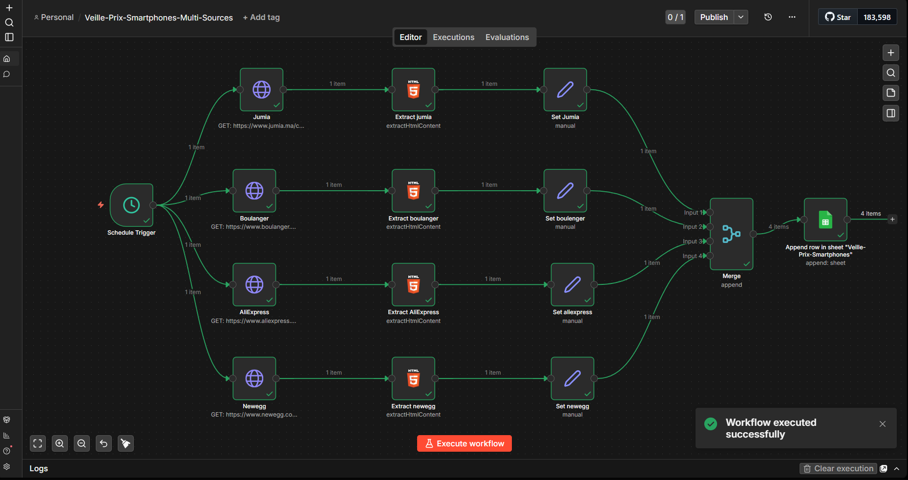
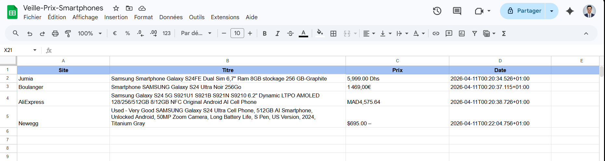

# Web Scraping & Automated Price Monitoring

**A Practical Exploration of Web Data Extraction, Browser Automation and No-Code Workflow Orchestration.**

A dual-part project combining Python and Selenium for extracting and analyzing Yelp restaurant and reviewer data, with n8n and Docker for automating product price monitoring across multiple e-commerce platforms.

Academic project — **Big Data & Artificial Intelligence**, National School of Applied Sciences of Tetouan (ENSA).

**Author:** Abdessamad Ait Brahim  
**Module:** Web Analytics  
**Supervisor:** Dr. Imad Sassi

---

<div align="center">

[](https://www.python.org/)
[](https://www.selenium.dev/)
[](https://n8n.io/)
[](https://www.docker.com/)
[](https://sheets.google.com/)

[](#project-overview)
[](#1-yelp-web-scraping)
[](#2-automated-price-monitoring)
[](#project-results-and-visualizations)
[](#installation-and-execution)
[](#author)

</div>

---

## 1. Project Overview

Web scraping and workflow automation are powerful techniques for collecting, processing and analyzing information available on the web.

This project explores two complementary approaches:

- **Programmatic Web Scraping:** Extracting structured information from Yelp using Python and Selenium.
- **No-Code Workflow Automation:** Building an automated product price monitoring system using n8n, Docker and Google Sheets.

### Main objectives

- Extract and structure data from real-world websites.
- Automate browser interactions using Selenium.
- Collect restaurant and reviewer information from Yelp.
- Analyze reviewer nationalities and generate rankings.
- Automate product price monitoring across e-commerce platforms.
- Integrate automated workflows with Google Sheets.
- Explore both code-based and low-code approaches to web data collection.

## 2. Yelp Web Scraping (Python & Selenium)

The first exercise focuses on extracting information from Yelp to analyze restaurants and reviewer profiles.

### Objective

Scrape the **500 best-rated restaurants in Paris** on Yelp, collect reviewer information and generate a ranking of reviewer nationalities.

### Key features

**Browser Automation**
- Automated navigation using Selenium WebDriver.
- Chrome DevTools Protocol (CDP) configuration.
- Persistent Chrome browser profile.
- Randomized delays between interactions.

**Scraping Reliability**
- Checkpoint-based progress saving.
- Ability to resume scraping after interruptions.
- Structured storage of extracted information.

**Data Analysis**
- Extraction of reviewer information.
- Nationality analysis.
- Generation of a JSON nationality ranking.

### Output files

| File | Description |
|---|---|
| `scrape_yelp/yelp_scraper.py` | Main Python scraping script |
| `results/checkpoint.json` | Scraping progress and checkpoint |
| `results/nationality_ranking.json` | Nationality ranking |
| `results/results_reviewers.csv` | Extracted reviewer dataset |

## 3. Automated Price Monitoring (n8n & Docker)

The second exercise implements an automated price monitoring workflow using n8n.

### Objective

Build an automated system to collect product titles and prices for the **Samsung Galaxy S24** from four e-commerce platforms:

- Jumia
- Boulanger
- AliExpress
- Newegg

The collected information is automatically sent to Google Sheets for centralized monitoring and analysis.

### Workflow architecture

**Automated Process:**

1. **Schedule Trigger:** Starts the workflow every 24 hours.
2. **Web Extraction:** Retrieves product information from target websites.
3. **HTML Extraction:** Uses CSS selectors through the `HTML Extract` node.
4. **Data Processing:** Organizes extracted product titles and prices.
5. **Google Sheets Integration:** Stores results automatically using OAuth2 authentication.

### Workflow screenshots

**n8n Workflow Editor**



**Successful Workflow Execution**



### Google Sheets Integration

The extracted product information is automatically stored in Google Sheets, providing a centralized view of price monitoring results.



### Output files

| File | Description |
|---|---|
| `n8n-scraping/docker-compose.yml` | Docker configuration for n8n |
| `n8n-scraping/workflow-veille-prix.json` | Exported n8n workflow |
| `results/Veille-Prix-Smartphones.xlsx` | Collected price monitoring data |

## 4. Technology Stack

| Component | Technology |
|---|---|
| Programming Language | Python |
| Browser Automation | Selenium WebDriver |
| Browser Configuration | Chrome DevTools Protocol |
| Workflow Automation | n8n |
| Containerization | Docker & Docker Compose |
| Data Integration | Google Sheets API / OAuth2 |
| Data Formats | JSON, CSV, XLSX |
| Web Extraction | HTML & CSS Selectors |

## 5. Project Structure

```text
web-scraping-yelp-n8n/
│
├── .gitignore
├── README.md
│
├── scrape_yelp/
│   ├── yelp_scraper.py
│   └── requirements.txt
│
├── n8n-scraping/
│   ├── docker-compose.yml
│   └── workflow-veille-prix.json
│
├── results/
│   ├── checkpoint.json
│   ├── nationality_ranking.json
│   ├── results_reviewers.csv
│   └── Veille-Prix-Smartphones.xlsx
│
└── docs/
    └── images/
        ├── n8n-workflow-editor.png
        ├── n8n-workflow-success.png
        └── google-sheets-results.png
```

## 6. Installation and Execution

### Prerequisites

- Python 3.x
- Google Chrome
- Docker Desktop
- Git
- Google account for Google Sheets integration

### Step 1 — Clone the repository

```bash
git clone https://github.com/abdessamadaitbrahim/web-scraping-yelp-n8n.git

cd web-scraping-yelp-n8n
```

### Step 2 — Run the Yelp scraper

Navigate to the scraping directory:

```bash
cd scrape_yelp
```

Create and activate a virtual environment:

```bash
python -m venv .venv
```

**Windows:**

```bash
.venv\Scripts\activate
```

**Linux / macOS:**

```bash
source .venv/bin/activate
```

Install dependencies and execute:

```bash
pip install -r requirements.txt

python yelp_scraper.py
```

### Step 3 — Launch n8n using Docker

From the project root:

```bash
cd n8n-scraping

docker compose up -d
```

### Step 4 — Configure the workflow

Open the n8n interface:

[http://localhost:5678](http://localhost:5678)

Then:

1. Import `workflow-veille-prix.json`.
2. Configure Google Sheets OAuth2 credentials.
3. Verify the target websites and CSS selectors.
4. Execute the workflow.
5. Activate the scheduled workflow for automatic monitoring.

## 7. Project Results and Visualizations

The project demonstrates two practical applications of web data extraction and automation.

### Yelp Scraping

- Collection of restaurant and reviewer information.
- Checkpoint-based scraping execution.
- Structured CSV and JSON outputs.
- Nationality ranking generation.

### Automated Price Monitoring

- Automated collection of Samsung Galaxy S24 product information.
- Monitoring across four e-commerce platforms.
- Scheduled execution every 24 hours.
- Centralized results in Google Sheets.
- Exportable Excel dataset.

## 8. Documentation

The complete academic report provides additional information about:

- Project methodology.
- Implementation details.
- Technical challenges.
- Results and observations.

**Project Report:** See the PDF report included in the repository.

## 9. Author

**Abdessamad Ait Brahim**

Big Data & Artificial Intelligence Student  
National School of Applied Sciences of Tetouan (ENSA)

**Module:** Web Analytics  
**Supervisor:** Dr. Imad Sassi

GitHub: [@abdessamadaitbrahim](https://github.com/abdessamadaitbrahim)

Repository: [web-scraping-yelp-n8n](https://github.com/abdessamadaitbrahim/web-scraping-yelp-n8n)

---

<div align="center">

**WEB SCRAPING & AUTOMATED PRICE MONITORING**

*Extract · Analyze · Automate · Monitor*

Python · Selenium · n8n · Docker · Google Sheets

Developed at ENSA Tetouan

</div>